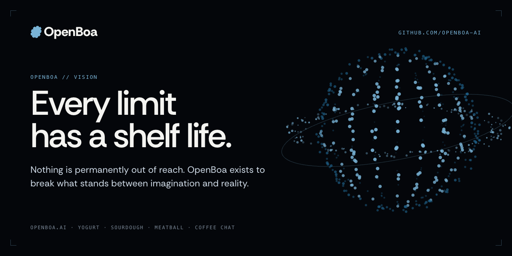

  

<h1 align="center">OpenBoa</h1>

  <strong>Every limit has a shelf life.</strong> 
  Nothing is permanently out of reach. OpenBoa exists to break what stands between imagination and reality.

  <a href="https://openboa.ai">Website</a> ·
  <a href="https://yogurt.openboa.ai/">Yogurt Design System</a> ·
  <a href="https://x.com/openboa_ai">X</a>

---

## Public Projects

**OpenBoa** (*Boa* = **Business of Agents**) builds autonomous companies, tools, and interfaces in the open—where human direction meets continuous execution.

| Mark | Project | Slogan | Overview |
| :---: | :--- | :--- | :--- |
|  | **[openboa.ai](https://github.com/openboa-ai/openboa.ai)** | *Every limit has a shelf life.* | OpenBoa’s official website — vision, approach, and interactive 3D identity. |
|  | **[yogurt](https://github.com/openboa-ai/yogurt)** | *ships with live cultures* | OpenBoa’s design system and UI SDK — shared tokens, original artwork, product language, and React components. |
|  | **[sourdough](https://github.com/openboa-ai/sourdough)** | *put the dough to work* | An autonomous quantitative fund operated by AI agents under a standing mandate. |
|  | **[meatball](https://github.com/openboa-ai/meatball)** | *keep the ball rolling* | A supervisor for delegated software work — turning goals into reviewed specs, isolated agent work, and verified delivery. |
|  | **[coffee-chat](https://github.com/openboa-ai/coffee-chat)** | *ground for good taste* | Capture explicitly confirmed human perspective and apply it reliably across human collaboration and agent judgment. |
